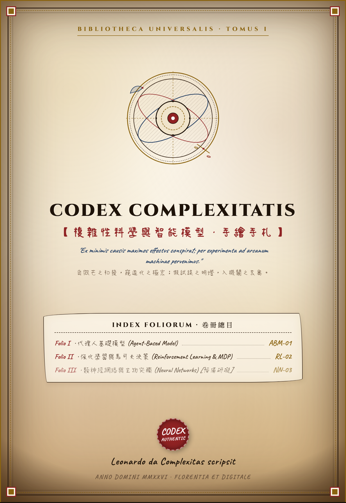
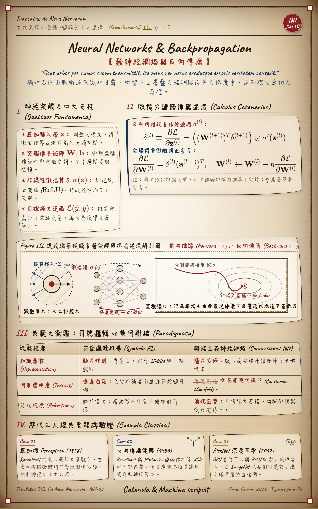
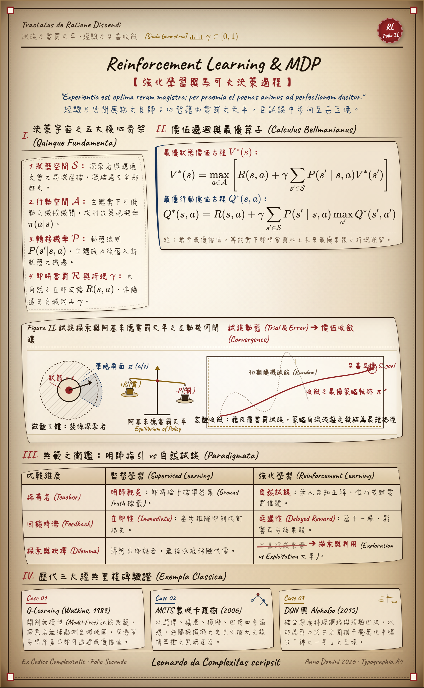
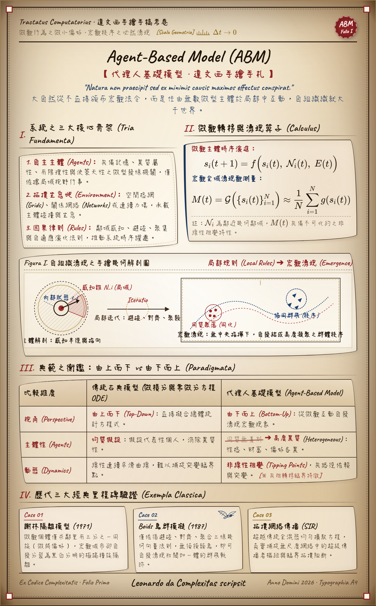

# 達文西手繪手札知識圖卡系統 (Da Vinci Codex Infographics)

> 💡 **快速檢視**：
> 🌐 [線上圖卡總覽 (GitHub Pages)](https://wu-kenny-0531.github.io/-/) ｜ 📜 [查看設計指南 STYLE_GUIDE.md](STYLE_GUIDE.md) ｜ 🤖 [查看專案規範 AGENTS.md](AGENTS.md)

---

## 🖼️ 圖卡典藏畫廊 (Folio Gallery)

### 00. Codex Complexitatis (典藏集總封面 · Frontispiece)
> 📥 [下載高解析度 A4 封面 PNG 原圖](png/00_cover.png) ｜ 🌐 [查看網頁版](html/00_cover_davinci.html) ｜ 📝 [閱讀封面概念筆記](notes/00_codex_cover.md)

  

 

### 03. Neural Networks & Backpropagation (類神經網絡與反向傳播)
> 📥 [下載高解析度 A4 PNG 原圖](png/03_neural_networks.png) ｜ 📥 [下載 1:1 社群方圖 (1600x1600)](png/03_neural_networks_square.png) ｜ 🌐 [查看網頁版](html/03_neural_networks_davinci.html) ｜ 📝 [閱讀主題筆記](notes/03_neural_networks.md)

  
  
📱 同步推出 1:1 正方形社群版：<a href="png/03_neural_networks_square.png" target="_blank">檢視 1:1 社群高清圖</a>

 

### 02. Reinforcement Learning & MDP (強化學習與馬可夫決策過程)
> 📥 [下載高解析度 A4 PNG 原圖](png/02_reinforcement_learning.png) ｜ 🌐 [查看網頁版](html/02_reinforcement_learning_davinci.html) ｜ 📝 [閱讀主題筆記](notes/02_reinforcement_learning.md)

  

 

### 01. Agent-Based Model (代理人基礎模型)
> 📥 [下載高解析度 A4 PNG 原圖](png/01_agent_based_model.png) ｜ 🌐 [查看網頁版](html/01_agent_based_model_davinci.html) ｜ 📝 [閱讀主題筆記](notes/01_agent_based_model.md)

  

---

## 專案結構與模組

* **`notes/`**：主題知識筆記（分流「核心圖卡區」與「延伸補充區」）
* **`html/`**：單頁 A4 教學圖卡網頁（內建 KaTeX 與 CSS/JS/SVG 解說圖表）
* **`png/`**：高解析度 300 DPI 印刷級圖卡成品
* **`scripts/`**：Python 自動轉檔截圖工具 (`generate_png.py`)
* **`upload.bat`**：雙擊一鍵同步推送到 GitHub
* **`export_png.bat`**：雙擊一鍵重新生成 PNG 圖卡
* **[`STYLE_GUIDE.md`](STYLE_GUIDE.md)**：專屬視覺設計指南（色調、筆觸、角色、構圖四大維度）
* **[`AGENTS.md`](AGENTS.md)**：Agent 協作與分階段確認制守則
